<p align="center">
  
</p>

  

**Snake**, built from scratch with plain Android Views. Steer the snake with on-screen arrows, eat the food to grow longer and faster, and don't hit the walls. No game engine, no Canvas — every snake segment is an `ImageView` moved by a `Handler` loop.

## Features

- **Classic Snake gameplay** — eat, grow, survive
- **Speeds up** with every piece of food eaten
- **Four-direction control pad** plus pause / resume
- **Wall collision** turns the board border red and ends the game
- **Live score** and a final *Game Over — Play Again* screen

## How it works

### The game loop
A `Runnable` re-posts itself on a `Handler` every `delayMillis` milliseconds. Each tick:

1. Every body segment moves to the position of the segment in front of it.
2. The head moves 10 px in the current direction.
3. The head is checked against the walls and against the food.

```kotlin
for (i in snakeSegments.size - 1 downTo 1) {
    snakeSegments[i].x = snakeSegments[i - 1].x
    snakeSegments[i].y = snakeSegments[i - 1].y
}
```

### Eating
Food collision uses the Euclidean distance between the head and the food. Under 50 px, a new `ImageView` segment is added, the food jumps to a random spot, the score goes up and `delayMillis` drops by one — which is what makes the snake faster.

## Project structure

```
com.example.androidgames
└── MainActivity.kt
```

<sub>1 source file · 203 lines of code · 1 layout</sub>

## Tech stack

| | |
|---|---|
| **Language** | Kotlin |
| **UI** | XML layouts |
| **Min / Target SDK** | 24 / 34 |

## Getting started

```bash
git clone https://github.com/rajabbov/AndroidGames.git
```

1. Open the folder in **Android Studio** (Ladybug or newer).
2. Let Gradle sync.
3. Run the `app` configuration on a device or emulator.

## Known limitations

- The snake doesn't yet collide with its own body.

---

Made by **Ibrohimjon Rajabboyev** · [@rajabbov](https://github.com/rajabbov)
